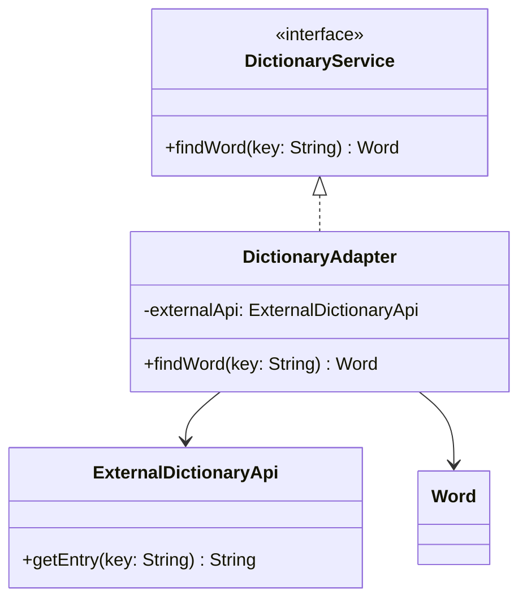
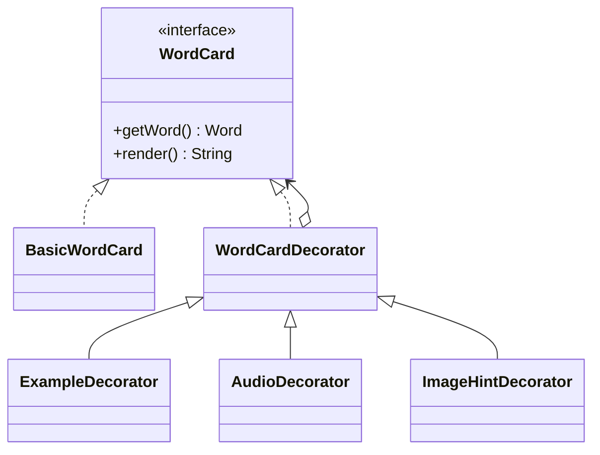
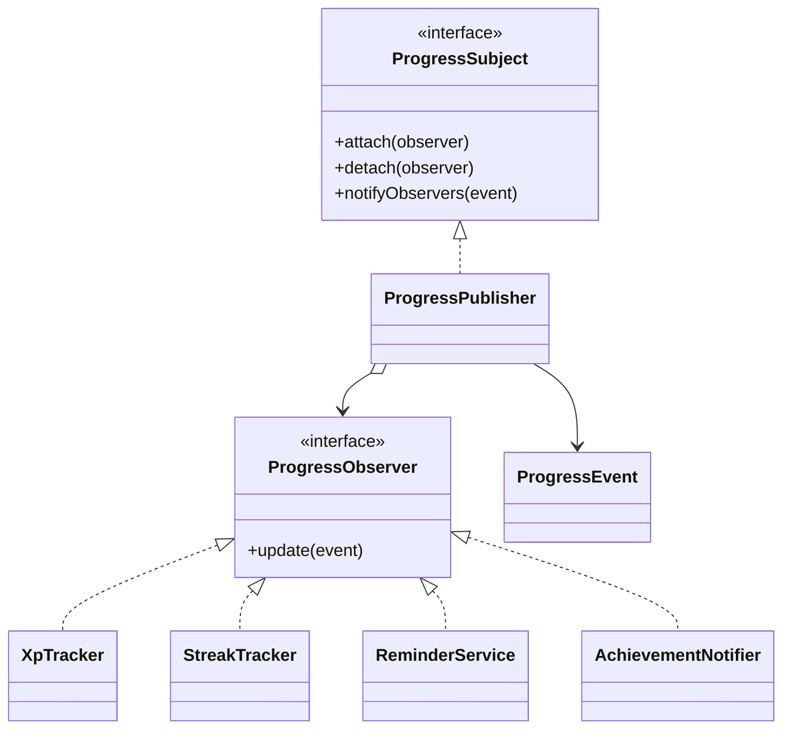

# Turar Report Sections

## Adapter

The application receives dictionary data from `ExternalDictionaryApi`, a third-party class whose `getEntry` method returns a string such as `apple|яблоко`. The rest of the application works with the internal `Word` model, so it should not depend on that external format.

`DictionaryService` defines the application-facing operation `findWord`. `DictionaryAdapter` implements this interface, calls `ExternalDictionaryApi`, validates the delimiter-separated response, and converts it into a `Word`. This isolates the external API and makes the rest of the application independent of its inconvenient representation.

## Decorator

`WordCard` is the common component interface and `BasicWordCard` is the base component. `WordCardDecorator` keeps a reference to another `WordCard` and delegates to it. `ExampleDecorator`, `AudioDecorator`, and `ImageHintDecorator` add features without modifying the base card. Because every decorator implements the same interface, several decorators can be wrapped in sequence.

## Observer

`ProgressPublisher` is the subject and stores a list of `ProgressObserver` subscribers. After an answer is processed, `LearningFacade` creates a `ProgressEvent` containing the word, correctness, and next review interval, then calls `notifyObservers`.

The subscribers have independent responsibilities:

- `XpTracker` adds 10 XP after a correct answer.
- `StreakTracker` updates the current correct-answer streak.
- `ReminderService` prints when the word should be reviewed again.
- `AchievementNotifier` counts correct answers and announces an achievement after every ten correct answers.

This design allows a new reaction to progress events to be added without changing the publisher or the other subscribers.

## Further work

The next improvements could include persisting `UserSession` to a database, replacing console reminders with scheduled notifications, loading dictionary entries from a real API, and adding configurable achievement milestones. Observer tests should also verify subscriber removal with `detach` and behavior after incorrect answers.

## UML

### Adapter

### Decorator

### Observer

