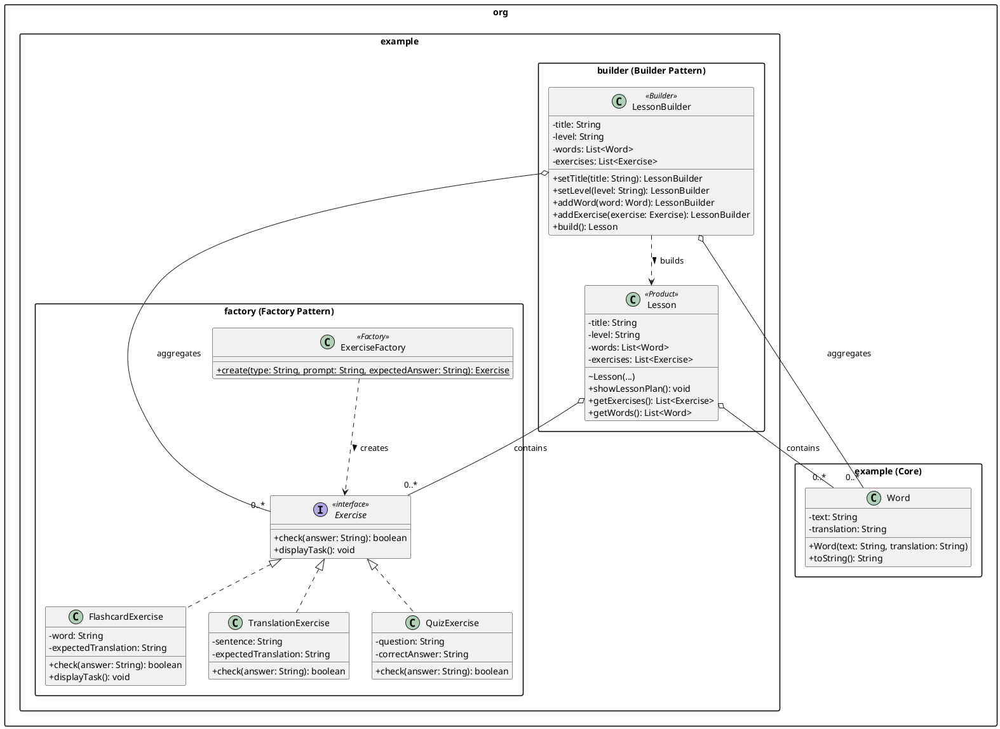

# Subsystem Architecture: Content Generation

**Individual report on Builder and Factory Method patterns (Yelzhan)**

As part of the development of the Language Learning App, a subsystem for generating educational content was designed and implemented. The main goal of this module is to provide flexible creation of various types of exercises and their subsequent convenient assembly into unified study sessions (lessons). To solve these architectural tasks, the creational design patterns **Factory Method** and **Builder** were applied.

## 1. Factory Method Pattern (Exercises)

The Factory Method pattern is used to encapsulate the logic of creating exercise objects. The application features multiple types of activities: flashcards, multiple-choice quizzes, and translation tasks. Directly creating these objects using the `new` operator would tightly couple the high-level logic to specific classes.

| Component | Purpose in the project | 
| ----- | ----- | 
| `Exercise` (Product) | Common interface for all educational tasks. Guarantees the presence of mandatory methods, such as `check(String answer)` for verifying user input. | 
| `FlashcardExercise`, `TranslationExercise`, `QuizExercise` (Concrete Products) | Concrete implementations of exercises. Each implementation contains its own unique logic for answer verification and displaying the task to the screen. | 
| `ExerciseFactory` (Creator) | Factory providing the static method `create(type, prompt, expectedAnswer)`. Depending on the passed string type, the factory decides which specific class instance to instantiate. | 

**Justification:** Using a Factory allows the system to be easily expanded. When adding a new exercise type (e.g., listening), it is sufficient to create a new class implementing the `Exercise` interface and add a single `case` to the factory method, without touching the code that uses these exercises.

## 2. Builder Pattern (Lesson Assembly)

An educational lesson (`Lesson`) is a complex, composite object. It contains metadata (title, difficulty level), lists of new vocabulary words, and lists of generated exercises. The Builder pattern solves the "telescoping constructor" anti-pattern and constructs this object step-by-step.

* **Mandatory Field Control:** The `build()` method in the `LessonBuilder` class validates the state before creating the object (checks for the presence of a title and level). If the data is incomplete, an `IllegalStateException` is thrown.

* **Integration with Factory:** The builder accepts `Exercise` objects as parameters, which are previously generated by the Factory. This demonstrates the seamless integration of patterns into a unified workflow.

* **Readability:** Using a "fluent interface" (returning `this` from setter methods) allows assembling a lesson as a convenient and readable chain of method calls.

## 3. Detailed Breakdown of the Lesson Class

In the implemented architecture, the `Lesson` class acts as the final Product created by the Builder. Its architectural features include:

First, the constructor of the `Lesson` class has a package-private access modifier. This is done intentionally: objects of this class cannot be created directly from other modules (e.g., from `Facade` or `Main`). The only permitted way to obtain a `Lesson` instance is to use `LessonBuilder`, which guarantees data integrity and validity.

Second, `Lesson` is an aggregator of domain entities. It encapsulates lists of `Word` objects (vocabulary to study) and `Exercise` objects (practical part). The provided getters (`getWords()` and `getExercises()`) allow gamification (Observer/Decorator) and adaptive learning (Strategy) subsystems to iterate through the lesson's content without delving into the process of its initial construction.

## 4. UML Diagram

The following class diagram illustrates the structure and relationships of the implemented Builder and Factory patterns within the core architecture:

